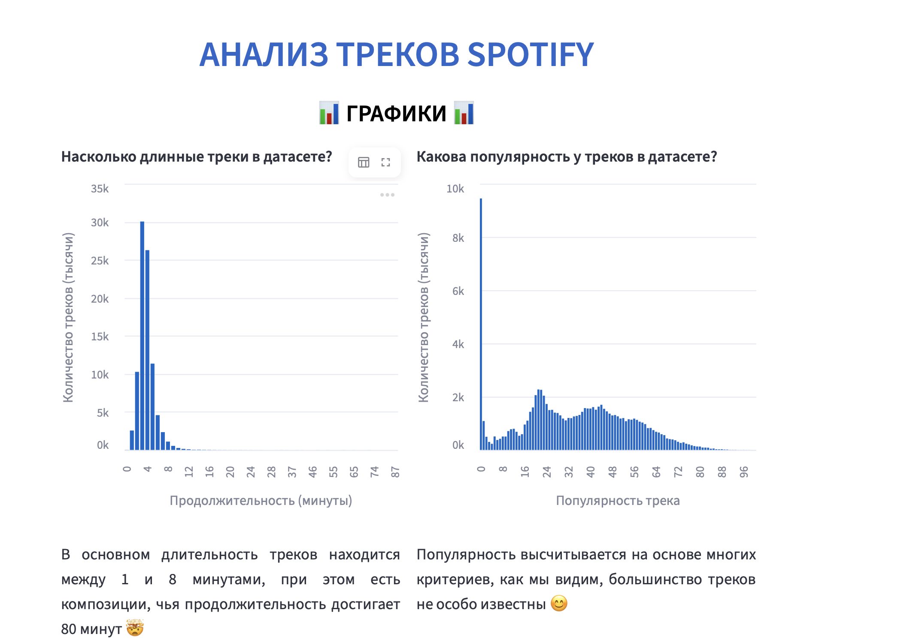
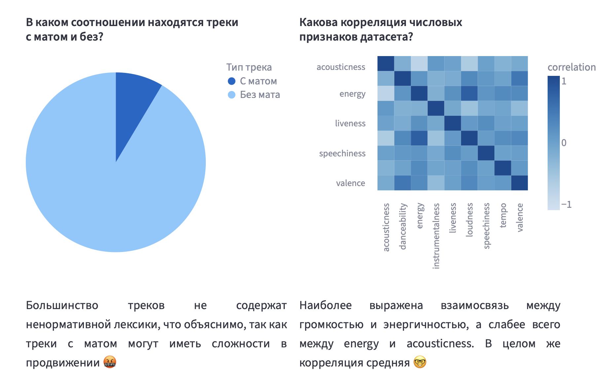
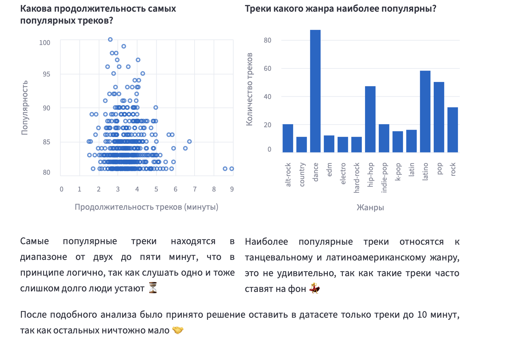
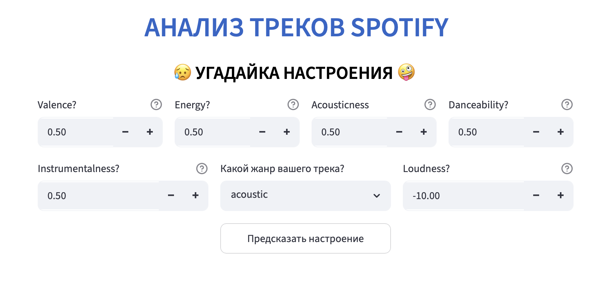

# Анализ треков Spotify

Интерактивный дашборд на Streamlit: исследовательский анализ данных (EDA) и калькулятор настроения трека на основе линейной регрессии.

Проект учебный: цель пройти этапы обработки данных, EDA, настроить модель регрессии и построить Дашборд.

## Что внутри

- **EDA:** несколько графиков, для исследования данных:
    1) Гистограмма продолжительности треков в датасете;
    2) Гистограмма популярности трека в датасете;
    3) Круговая диаграмма доли треков с нецензурной лексикой;
    4) Матрица корреляций числовых признаков в датасете;
    5) Точечная диаграмма продолжительности самых популярных треков;
    6) Столбчатая диаграмма распределения популярности треков по жанрам. 





- **Предсказание настроения:** калькулятор, который по вводимым параметрам (выбранные на основе EDA и здравого смысла) может предсказать какая будет по настроению песня (отнести ее к грустным, нейтральным или радостным).




## Предобработка данных
Удалил пропуски, выделил только первого исполнителя, перевел длительность трека из миллисекунд в минуты, добавил признаки `mood_score`, `acoustic_sadness`, `is_popular`.
Непосредственно перед обучением модели закодировал категориальные колонки, используя OneHotEncoder, а затем выполнил нормировку, используя StandardScaler. 

## Модель
- sklearn.linear_model.LinearRegression - линейная регрессия. 
- Целевая переменная - `mood_score = valence * energy`.
- Признаки: valence, energy, acousticness, danceability, instrumentalness, loudness, жанр.
- Разбиение train/test 67/33. 
- Метрики на тестовой выборке: R² = 0.93; MAE = 0.04. 
Обученная модель была сохранена с помощью pickle. 

### Ограничения модели

`mood_score` вычисляется из `valence` и `energy`, а эти же признаки подаются
на вход модели (утечка целевой переменной). Поэтому высокий R² не говорит
о предсказательной силе: по сути модель приближает известную формулу.

Для проверки я обучил модель без `valence` и `energy`: R² упал до 0.48.
Это более честная оценка того, насколько настроение можно предсказать
по остальным характеристикам трека.

Посмотреть, как работает модель без утечки можно запустив файл `experiment_no_leakage.py`. 

Основная версия оставлена с полным набором признаков, потому что проект
учебный: цель была отработать весь цикл от обработки данных до модели
и дашборда, а не получить содержательный прогноз.

## Стек технологий
Python, pandas, scikit-learn, Streamlit, Altair

## Как запустить
```bash
pip install -r requirements.txt
streamlit run main.py
```

## Структура проекта

```
Spotify-analysis/
│
├── main.py                  # Интерфейс Streamlit: EDA и предсказание
├── preparations.py          # Очистка данных, подготовка признаков
├── models.py                # Обучение и сохранение модели
├── predict_mood_score.pkl   # Обученная модель
├── dataset.csv              # Датасет треков Spotify
├── requirements.txt         # Зависимости проекта
├── experiment_no_leakage.py # Файл с моделью без утечки целевой переменной
└── README.md                # Документация
```

## Данные

Датасет Spotify Tracks Dataset, автор maharshipandya
(https://www.kaggle.com/datasets/maharshipandya/-spotify-tracks-dataset).
Лицензия: Open Database License (ODbL), права на содержимое принадлежат
первоисточнику (Spotify). Проект учебный, некоммерческий.